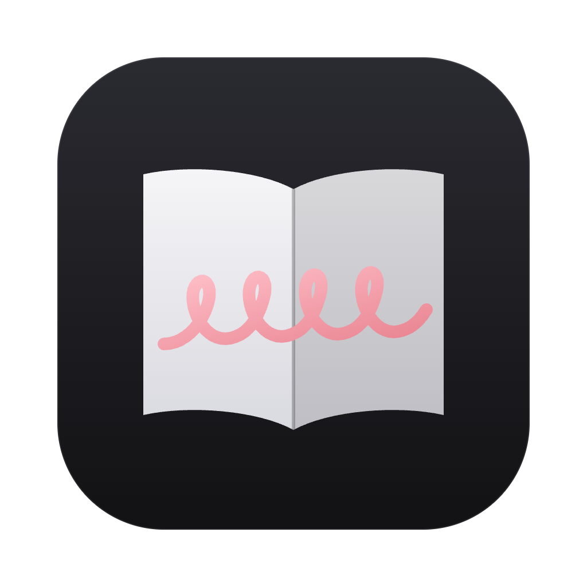
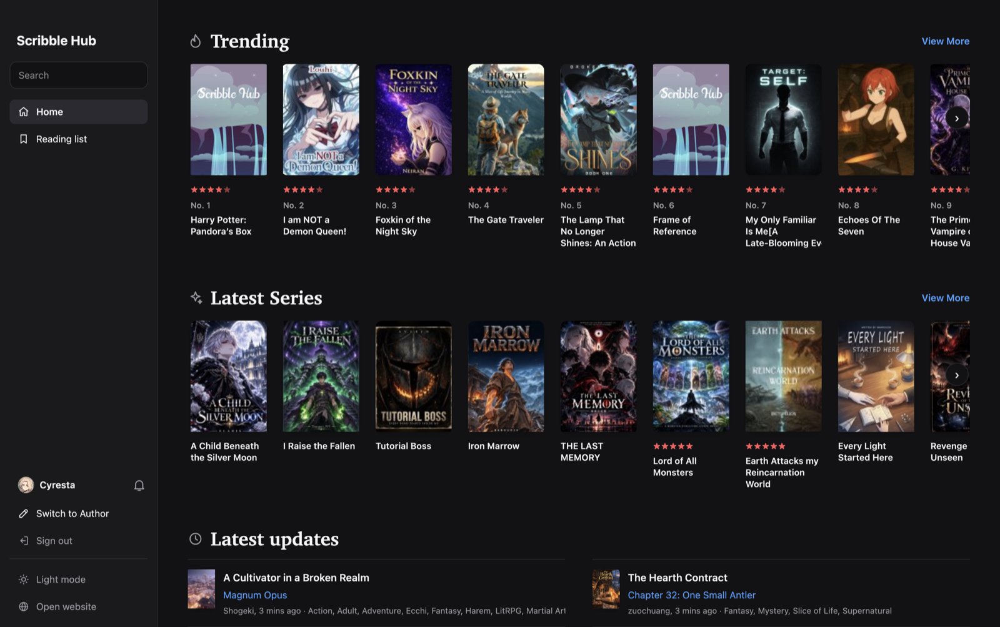

<div align="center">



# Scribble Hub Desktop

An unofficial desktop app for [scribblehub.com](https://www.scribblehub.com) on macOS and Windows, written in Rust with [GPUI](https://www.gpui.rs).<br>
Read, keep up with your reading list, and write and publish your own series without opening a browser.

[**Download**](https://github.com/oss-aryanroy/ScribbleHubApp/releases/latest)



</div>

## Download

Grab the file for your computer from the [latest release](https://github.com/oss-aryanroy/ScribbleHubApp/releases/latest):

| | |
|---|---|
| Mac with Apple Silicon (M1 and later) | `ScribbleHub-…-macos-arm64.zip` |
| Mac with Intel | `ScribbleHub-…-macos-x86_64.zip` |
| Windows PC (most) | `ScribbleHub-…-windows-x86_64.exe` |
| Windows on ARM (Snapdragon, Parallels on a Mac) | `ScribbleHub-…-windows-arm64.exe` |

On macOS, unzip and move **Scribble Hub** to Applications. The builds aren't notarized, so the first time, right-click the app and choose **Open**. On Windows, SmartScreen may warn the first time; choose **More info → Run anyway**.

Needs macOS 11 or later, or Windows 10/11 (which include the WebView2 runtime). Linux isn't supported yet.

## Building from source

```sh
cargo run --release                      # home page
cargo run --release -- <series or chapter URL>
```

Needs a recent stable Rust (edition 2024). On Windows you also need Visual Studio Build Tools with the C++ workload, and on Windows ARM64, LLVM's `clang` on `PATH`.

## What's in it

**Reading**
- Home, search, series pages, and a chapter reader with themes, serif/sans and text size
- Reading list, notifications, and your account settings

**Writing** (Switch to Author in the sidebar)
- Dashboard with stats for each series; create and edit series, glossary and related series
- Rich-text chapter editor: headings, lists, quotes, colours, links, images and scene breaks
- Reorder and delete chapters
- Focus mode with typewriter scrolling and adjustable font, width and line spacing
- Daily and session word goals, streaks, a deadline planner and timed sprints (**Today** in the sidebar)
- Autosave to disk, version history with side-by-side compare, and drafts that wait for you to come back online
- An outline board for each series with chapter status, notes and story-beat templates
- Find and replace across every chapter, plus hints for repeated words, adverbs, passive voice and long sentences

## How it works

Scribble Hub sits behind Cloudflare, so pages are loaded in a hidden system web view (WebKit on macOS, WebView2 on Windows) and parsed into native UI.
If the site asks for a human check, the live page is shown so you can complete it yourself.
You sign in on the site's own login page; the app never sees your password, and the web view keeps the session.
Writes go through the same forms and AJAX actions the site's own pages use.
Password and email changes stay on the website.

**Open website** (⌘L) shows the live site for anything the app doesn't cover yet.

Writing data (goals, outlines, drafts and history) lives in `~/Library/Application Support/ScribbleHub/` on macOS and `%APPDATA%\ScribbleHub` on Windows.

## Keys

On Windows, use Ctrl wherever this says ⌘.

| | |
|---|---|
| ⌘F | Search, or find in the chapter you're editing |
| ← / → | Previous / next chapter |
| ⌘= / ⌘- | Text size |
| `t` / `f` | Theme / serif or sans |
| Esc, ⌘[ | Back |
| ⌘L | Open the live website |
| ⌘B ⌘I ⌘U | Bold, italic, underline |
| ⇧⌘F | Focus mode |
| ⌘Z / ⇧⌘Z | Undo / redo |

## Layout

| File | |
|---|---|
| `src/main.rs` | Window, sidebar, reader pages |
| `src/site.rs` | HTML parsing for reader pages |
| `src/web.rs` | Hidden web view and requests |
| `src/studio.rs` | Author dashboard and chapter editor |
| `src/manage.rs` | Chapter list, glossary, related series |
| `src/account.rs` | Account settings |
| `src/rich.rs` | Rich-text editor |
| `src/input.rs` | Text field |
| `src/desk.rs` | Goals, focus mode, outline, history, find |
| `src/writer.rs` | Writing data, diffs and text stats |
| `src/markup.rs` | HTML helpers |

The only UI library is GPUI; the text field and editor are built on its `EntityInputHandler`.

## Releases

Push a version tag and GitHub Actions builds macOS (Apple Silicon and Intel) and Windows (x86_64 and ARM64), then publishes them as a release:

```sh
git tag v0.1.0
git push origin v0.1.0
```

## Fonts

The app ships [Charis SIL](https://software.sil.org/charis/) and [Literata](https://github.com/googlefonts/literata) for reading and writing, both under the SIL Open Font License (`assets/fonts/`). The interface uses the system font. The app icon's source is `assets/icon/icon.svg`.

## Tests

```sh
cargo test
```

The parser tests run against pages saved from the site into `tests/fixtures/`. Those pages aren't in the repo, since they contain account data and other authors' writing, so save your own copies there before running the tests. When Scribble Hub changes its markup, refresh the page and fix `src/site.rs`.

## Disclaimer

This is an independent project. It isn't made by, affiliated with or endorsed by Scribble Hub.
